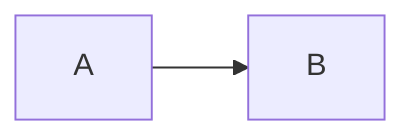

# Rebuild Lab Website

A static technical-publication site for Rebuild Lab: a registry of system and research reproductions, each documented as an engineering record. There is no database and no server runtime.

Stack: Next.js 16.4.4 (App Router, Turbopack), React 19, TypeScript (strict), Tailwind v4, `output: "export"`. The registry is YAML validated with Zod 4; long-form project records are MDX (`@next/mdx`). Tests use Vitest. Node version is pinned in `.nvmrc` (24).

> This is not the Next.js you may know. See `AGENTS.md` and read `node_modules/next/dist/docs/` before changing framework-level code.

## Routes

| Route | Content |
|---|---|
| `/` | Hero, featured project, the 9 laboratories (`#laboratories`), project table |
| `/explore` | Full registry table with client-side filters (Domain, Status, Classification, Stack) |
| `/labs/[slug]` | One page per laboratory (9, from `lib/labs.ts`) |
| `/projects/[slug]` | Project record in 7 blocks (one page per registry entry) |
| `/about` | Charter: principles, scope, hardware disclosure, evidence standard |
| `/contribute` | Lifecycle, workflows, issue taxonomy (draft), gates, licensing, security placeholder |

Only these six routes exist. The header links to nothing else.

## Scripts

| Command | Purpose |
|---|---|
| `npm run dev` | Dev server at http://localhost:3000 |
| `npm run build` | Static export to `out/` |
| `npm run typecheck` | `next typegen && tsc --noEmit` (typegen creates the `LayoutProps` route types, so it works on a clean checkout) |
| `npm run lint` | ESLint |
| `npm run validate:content` | Validates `content/projects.yaml` and `content/projects/*.mdx` (`scripts/validate-content.ts`) |
| `npm test -- --run` | Vitest, single run (`npm test` alone starts watch mode) |
| `npm run verify` | Everything CI runs, in order: typecheck, lint, validate:content, tests, build |

CI (`.github/workflows/website-ci.yml`) runs on pull requests and pushes to `main` with read-only permissions, a 10-minute timeout and superseded-run cancellation: `npm ci`, typecheck, lint, `validate:content`, tests, build, `npm audit --omit=dev --audit-level=high`. Dependabot (`.github/dependabot.yml`) opens weekly grouped npm updates and monthly Actions updates.

## Adding a project

1. Add an entry to `content/projects.yaml`. The schema is strict (`lib/schema.ts`): unknown keys are rejected.

   | Field | Rule |
   |---|---|
   | `id` | One capital letter + 3 digits, e.g. `R004`; unique |
   | `title` | Non-empty string |
   | `slug` | Lowercase kebab-case; unique; becomes `/projects/<slug>` |
   | `category` | A laboratory slug from `lib/labs.ts` |
   | `classification` | Non-empty, unique subset of `reproduction`, `recreation`, `original-work` |
   | `status` | `PLANNED`, `RESEARCH`, `IN-PROGRESS`, `EXPERIMENTAL` or `COMPLETED` |
   | `languages` | At least one string |
   | `frameworks` | List of strings; may be empty |
   | `references` | List of http(s) URLs; may be empty |
   | `repository` | http(s) URL that starts with `https://github.com/<GITHUB_ORG>/` |
   | `difficulty`, `tags`, `featured`, `demo`, `summary` | Optional (`difficulty`: `foundational`, `intermediate` or `advanced`) |

   The org rule uses `GITHUB_ORG` in `lib/site.ts`. YAML cannot import it, so repository URLs must match it by hand; `validate:content` and the build fail if they do not.

   The GitHub org handle `rebuild-lab` (in `lib/site.ts` and in the `repository` URLs in `content/projects.yaml`) is provisional. To rename it, change `GITHUB_ORG` and update the URLs.

2. Optionally add `content/projects/<slug>.mdx` with the long-form record. Without it, the page shows "Not yet documented." for each block. `content/projects/resnet-from-scratch.mdx` is the authoring template.

3. Run `npm run validate:content`.

## The 7-block convention

Every project page renders seven blocks in this order:

1. Header & Status: generated from the YAML (ID, classification, status, laboratory, repository, references, languages, frameworks).
2. Problem & Objectives
3. Scope & Exclusions
4. Architecture & Data Flow
5. Benchmark & Evidence
6. Deviations & Failure Log
7. Reproducibility Commands

Blocks 2-7 come from the MDX file. It must contain exactly these six `##` headings, in this order (use `###` for sub-sections; no `#` title and no block 1). `validate:content` fails on missing, unexpected, duplicate or misordered headings, and on any MDX file with no matching registry slug (`lib/content-check.ts`).

Evidence standard for benchmark tables: state methodology, units and percentile definitions; do not invent numbers (see `/about#evidence`).

## Mermaid diagrams

Use a fenced block in the MDX:

````

````

The diagram source is always in the static HTML. After the page loads, `components/Mermaid.tsx` imports `mermaid` lazily and replaces the source with an SVG. If that fails, the source stays visible. Pages without diagrams load no Mermaid code.

## Deployment

`npm run build` writes a fully static site to `out/`, including `robots.txt` and `sitemap.xml`. Deploy that directory to Vercel or Cloudflare Pages (build command `npm run build`, output directory `out`, Node 24).

Set `NEXT_PUBLIC_SITE_URL` (e.g. `https://rebuildlab.dev`, no trailing slash) in the deploy environment. It feeds `metadataBase`, canonical URLs, the sitemap and `robots.txt`. Without it, a placeholder origin (`https://rebuild-lab.example`) is used.

Security and cache headers (nosniff, frame denial, HSTS, CSP, Referrer/Permissions-Policy, immutable caching for `/_next/static/*`) are defined for both hosts: `vercel.json` (Vercel) and `public/_headers` (Cloudflare Pages). Keep the two in sync. The CSP allows `'unsafe-inline'` scripts because Next injects inline bootstrap scripts into static HTML; tightening it needs nonces, which a static export cannot provide.

## Known gotchas

- **Stale `.next` cache.** After changing dependencies, if `next build` reports a missing module that is installed, run `rm -rf .next` and rebuild.
- **rolldown native binding.** After some `npm install` runs, Vitest fails with "Cannot find native binding" / missing `@rolldown/binding-darwin-arm64` (an npm optional-dependency issue). Fix: `rm -rf node_modules package-lock.json && npm install`.
- **Dev server caches the registry.** `getProjects()` caches in module scope, so after editing `content/projects.yaml` restart `npm run dev`.
- **Build validates YAML only through pages.** `next build` reads the registry only because pages import `lib/projects`; MDX heading and orphan checks are not part of the build. That is why CI also runs `npm run validate:content`.
- **MDX plugins must be string names.** Turbopack cannot take function plugins; see `next.config.mjs`.
