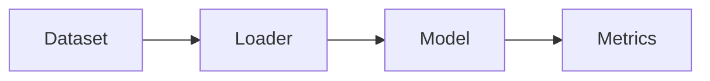

{/*
  Authoring template for a project record (Spec §5, blocks 2-7).
  Block 1 (Header & Status) is generated from content/projects.yaml, so it is not written here.
  Rules, enforced by `npm run validate:content`:
    - File name = registry slug (content/projects/<slug>.mdx).
    - Exactly these six `##` headings, in this order. Do not rename, add, or remove any.
    - Use `###` for sub-headings. Do not use `#`.
  Never publish numbers that were not measured. Use "—" until a value is recorded.
*/}

## Problem & Objectives

Placeholder. State the problem this project addresses and the source it reproduces or recreates.
List the objectives as testable statements, for example "reach the reported top-1 error on the
reference dataset within the stated tolerance".

## Scope & Exclusions

Placeholder. What is in scope, and what is explicitly out of scope and why (for example,
multi-GPU training is excluded because the reference hardware has one 4 GB VRAM GPU).

## Architecture & Data Flow

Placeholder. Describe components and data flow in prose, then keep the diagram below in sync.



## Benchmark & Evidence

Placeholder. Every value below is "—" until measured. Do not estimate.

| Metric            | p50 | p95 | p99 | Unit |
| ----------------- | --- | --- | --- | ---- |
| Latency           | —   | —   | —   | ms   |
| VRAM draw         | —   | —   | —   | MiB  |
| Throughput        | —   | —   | —   | —    |

### Methodology

Placeholder. Record all of the following for every result (Proposal §10.2):

- Environment: OS, driver and CUDA versions, hardware (GPU, VRAM, RAM).
- Workload: model, dataset, batch size, input shape, precision.
- Tool and version: the profiler or timer used, and its version.
- Number of runs, including warm-up runs that were discarded.
- Aggregation: how runs were combined (for example, median of per-run percentiles).
- Units: for every column.
- Which percentile: how p50, p95 and p99 were computed and over which samples.

## Deviations & Failure Log

Placeholder. Record every departure from the source and every failed run or abandoned approach,
with the date, what was tried, what happened, and the decision taken. Leave nothing out.

## Reproducibility Commands

Placeholder. Commands must run from a clean checkout. Replace with the real ones.

```bash
git clone https://github.com/rebuild-lab/resnet-reproduction.git
cd resnet-reproduction
# Replace the lines below with the real environment setup, training and evaluation commands.
python -m venv .venv
python -m pip install -r requirements.txt
```
